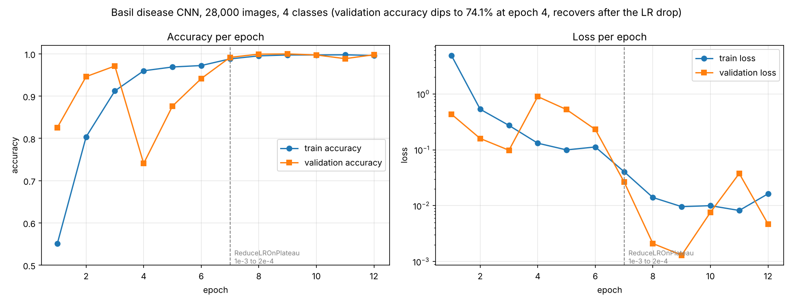

# Basil Leaf Disease Detection

A convolutional neural network that classifies basil leaf images into four
classes (bacterial, fungal, pests, healthy), trained from scratch in
TensorFlow/Keras and served through a Flask app that returns the predicted
class, the model's confidence, and a suggested remedy.

## The model

Built from scratch rather than fine-tuned, so every layer is accounted for:

| | |
|---|---|
| Input | 224 x 224 RGB, pixels scaled to 0-1 |
| Feature extractor | 4 blocks of Conv2D -> BatchNormalization -> MaxPooling, filters 32 / 64 / 128 / 256 |
| Head | Dense 512 -> Dropout 0.5 -> Dense 256 -> Dropout 0.3 -> Dense 4 softmax |
| Parameters | 26,213,316 |
| Optimizer | AdamW, initial learning rate 1e-3 |
| Loss | categorical crossentropy |
| Callbacks | EarlyStopping (patience 5, `restore_best_weights`), ReduceLROnPlateau (factor 0.2, patience 3), ModelCheckpoint (best only) |

Augmentation during training: rotation up to 30 degrees, width and height
shift 0.2, shear 0.2, zoom 0.2, horizontal flip, `fill_mode="nearest"`.

## Data

28,000 images across 4 classes, split 80/20 by `ImageDataGenerator(validation_split=0.2)`:
22,400 training and 5,600 validation, 1,400 validation images per class.

## Training run

Twelve epochs at roughly 40 minutes each. The per-epoch numbers in
[`training_history.json`](training_history.json) are the actual values Keras
printed, recovered from the notebook output after the kernel was interrupted
and the in-memory `history` object was lost.

```
python plot_training_history.py     # writes static/training_curves.png
```



Two things worth reading off that curve:

**Epoch 4 fell over.** Validation accuracy dropped from 97.1% to 74.1% and
validation loss went from 0.098 to 0.896, while training accuracy kept
climbing. The model had moved somewhere that fit the training batches and not
the validation set.

**The learning rate drop is what fixed it.** ReduceLROnPlateau cut the rate
from 1e-3 to 2e-4 going into epoch 7, and validation loss fell from 0.231 to
0.027 in a single epoch, then to 0.0013 by epoch 9. Best epoch by validation
loss is 9, which is the checkpoint the app loads.

## Results, and an honest caveat

Final validation accuracy is **99.87%**, with precision, recall and F1 all
reported as 1.00 for every class over 5,600 images.

**Those numbers are too good, and they should be read with suspicion.** Perfect
scores across four classes usually mean the validation set is not independent
of the training set. The likely cause here is that the dataset was expanded by
augmentation before the split rather than after it, so near-duplicate copies of
the same source photograph can sit on both sides of an 80/20 split that
`ImageDataGenerator` makes by file order. The exactly equal class counts
(7,000 each) point the same way.

What that means in practice: this result demonstrates that the architecture and
training setup work, not that the model would hold up at 99% on basil leaves
photographed by someone else. Fixing it properly means splitting by source
image before any augmentation, and ideally holding back a test set photographed
under different conditions. That work is not done here.

## Running it

```bash
pip install -r requirements.txt
python app.py                 # http://127.0.0.1:5000
```

The trained `.keras` file is not committed because of its size. Train it with
`train_model.ipynb`, or point the app at an existing copy:

```bash
MODEL_PATH=/path/to/basil_disease_best_model.keras python app.py
```

## Layout

```
app.py                      Flask app, model inference, remedy lookup
train_model.ipynb           data loading, model definition, training, evaluation
plot_training_history.py    plots the real curves from training_history.json
training_history.json       per-epoch accuracy and loss from the actual run
templates/                  index.html upload page, result.html prediction page
static/uploads/             uploaded images
models/                     trained .keras checkpoint (not committed)
```

## License

MIT.
