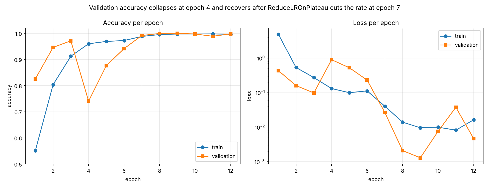

# Basil Leaf Disease Classification

A convolutional neural network that sorts basil leaf photographs into four
classes — bacterial, fungal, pests, healthy — built from scratch in
TensorFlow/Keras and served through a Flask app.

Trained on 28,000 images. Best validation loss 0.0013 at epoch 9.
**The headline accuracy is not trustworthy, and [`docs/evaluation.md`](docs/evaluation.md)
explains why** — read that before quoting any number from here.



## Quick start

```bash
pip install -r requirements.txt

python -m src.train --data-dir path/to/dataset   # train
python -m src.evaluate                           # confusion matrix + report
python -m src.plot_history                       # redraw the curve above
python -m app.main                               # web app on :5000
```

The dataset is not in this repository. It needs one subfolder per class, named
`bacterial`, `fungal`, `healthy`, `pests`.

## Layout

```
config.yaml              every tunable value, nothing hardcoded in the modules
src/
  config.py              typed access to config.yaml
  data.py                train/validation generators and augmentation
  model.py               the CNN definition
  train.py               training CLI, writes checkpoint and history
  evaluate.py            confusion matrix and classification report
  plot_history.py        training curve from recorded history
app/
  main.py                Flask app, lazy model loading, /health endpoint
  templates/             upload and result pages
artifacts/
  training_history.json  real per-epoch values from the recorded run
  training_curves.png    generated from that file
docs/evaluation.md       what the accuracy number means, and does not
notebooks/
  training_run.ipynb     the original exploratory run, with its output intact
tests/                   config contract and training-history guards
```

## The model

| | |
|---|---|
| Input | 224 x 224 RGB, scaled to 0-1 |
| Features | 4 blocks of Conv2D → BatchNormalization → MaxPooling, filters 32 / 64 / 128 / 256 |
| Head | Dense 512 → Dropout 0.5 → Dense 256 → Dropout 0.3 → Dense 4 softmax |
| Parameters | 26,213,316 |
| Optimizer | AdamW, initial learning rate 1e-3 |
| Loss | categorical crossentropy |
| Callbacks | EarlyStopping (patience 5, `restore_best_weights`), ReduceLROnPlateau (factor 0.2, patience 3), ModelCheckpoint (best only), HistoryWriter |

Augmentation is applied to the training generator only: rotation up to 30
degrees, width and height shift 0.2, shear 0.2, zoom 0.2, horizontal flip.
The validation generator is rescaled and nothing else, because augmenting it
would measure the augmenter rather than the model.

## Decisions worth explaining

**History is written to disk after every epoch.** The original run lost its
`history` object when the kernel was interrupted, which left the project with
no way to draw a training curve. `HistoryWriter` in `src/train.py` appends each
epoch to `artifacts/training_history.json` as it finishes, so an interrupted
run keeps everything up to the point it stopped.

**Class order is asserted in a test.** `flow_from_directory` sorts class folders
alphabetically. If the list in `config.yaml` drifts out of that order, every
prediction gets a confidently wrong label and nothing crashes.
`tests/test_config.py` fails instead.

**The model loads on first request, not at import.** Importing `app.main` used
to pull 100 MB of weights into memory, which made the app slow to start and
impossible to test without the checkpoint present. It is lazy now, and
`/health` reports whether the checkpoint is there.

**The learning rate schedule is the reason this run worked.** See the training
behaviour section of [`docs/evaluation.md`](docs/evaluation.md).

## Tests

```bash
pip install -r requirements-dev.txt
pytest -q
```

Six tests covering the config contract and the recorded history. They
deliberately do not require TensorFlow, so CI runs in under a minute on every
push. Training is not tested in CI; it needs a dataset and hours of compute.

## License

MIT.
